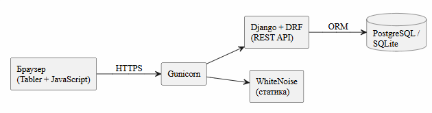

# Архитектура

Рисунок 1 - схема приложения.

## Компоненты

| Связь | Что передается | Формат |
|-------|----------------|--------|
| Браузер - сервер | страницы, запросы fetch(), статические файлы | HTTPS в облаке, HTTP локально; JSON |
| Gunicorn - Django | вызов config.wsgi:application | WSGI |
| Django - WhiteNoise | запросы к /static/ | middleware |
| Django - DRF | маршруты /api/ | JSON |
| DRF - ORM - база | запросы к моделям, транзакции | SQL |
| Переменные окружения - Django | DJANGO\_\* и DATABASE_URL при старте | переменные окружения |

## Путь запроса на примере выдачи оборудования

1. Браузер отправляет POST /api/reservations/{id}/issue/ с cookie сессии и заголовком X-CSRFToken.
2. Django определяет пользователя и проверяет токен.
3. ReservationViewSet берет только бронирования этого пользователя. Чужое бронирование - ошибка 404.
4. Функция issue_reservation() в одной транзакции проверяет статус и остаток, уменьшает остаток, меняет статус и записывает событие.
5. Страница получает ответ и обновляет данные без перезагрузки.

## Локально и на Render

| Параметр | Локально | Render |
|----------|----------|--------|
| Сервер | manage.py runserver | Gunicorn |
| База | SQLite (db.sqlite3) | PostgreSQL по DATABASE_URL |
| Статика | runserver при DJANGO_DEBUG=true | collectstatic и WhiteNoise |
| HTTPS | нет | дает платформа |
| Отладка | DJANGO_DEBUG=true | DJANGO_DEBUG=false |

## Доступ

- Все маршруты API требуют входа (сессия Django). Без входа - ошибка 403.
- Для POST, PUT, PATCH и DELETE нужен CSRF-токен.
- Пользователь видит только свои заявки и бронирования.

## Состояния бронирования

| Состояние | Что можно сделать | Следующее состояние |
|-----------|-------------------|---------------------|
| created | выдать, изменить, удалить | issued |
| issued | вернуть | returned |
| returned | ничего | - |

Любое другое действие сервер отклоняет с ошибкой 400.
