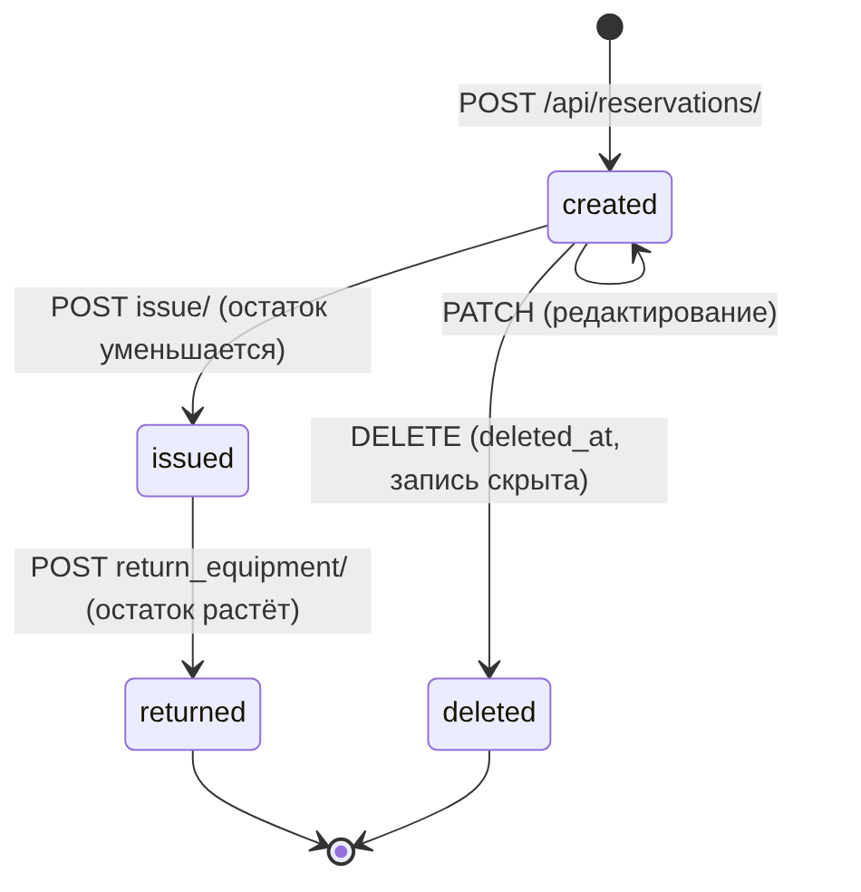

# Архитектура

*Рисунок 1 — компоненты и границы взаимодействия.*

## Компоненты и границы

| Граница | Что пересекает | Протокол / формат |
|---------|----------------|-------------------|
| Браузер → сервер приложений | HTML-страницы, запросы `fetch()`, статические файлы | HTTPS (в облаке), HTTP (локально); JSON |
| Gunicorn → Django | вызов WSGI-приложения `config.wsgi:application` | WSGI |
| Django → WhiteNoise | запросы `/static/...` перехватывает middleware до обработки представлениями | — |
| Django views → DRF | маршруты `/api/...` обрабатывают `ViewSet`'ы и сериализаторы | JSON |
| DRF → ORM → БД | запросы к моделям, транзакции `transaction.atomic` | SQL |
| Окружение → Django | `DJANGO_*`, `DATABASE_URL` читаются при старте | переменные окружения |

## Путь одного запроса

1. Браузер отправляет `fetch('/api/reservations/{id}/issue/', {method: 'POST'})` с cookie сессии и заголовком `X-CSRFToken`.
2. Gunicorn передаёт запрос Django; `SessionMiddleware` находит пользователя, `CsrfViewMiddleware` проверяет токен.
3. DRF-маршрутизатор вызывает `ReservationViewSet.issue`; `get_object()` сужает выборку до записей текущего пользователя (чужая запись → 404).
4. Сервисная функция `issue_reservation()` внутри `transaction.atomic` проверяет статус и остаток, уменьшает `available_q`, меняет статус и пишет событие.
5. Ответ — JSON обновлённого бронирования; интерфейс после ответа обновляет остатки, список и историю без перезагрузки страницы.

## Что отличается локально и в облаке

| Параметр | Локально | Render |
|----------|----------|--------|
| Сервер | `manage.py runserver` | Gunicorn (`config.wsgi:application`) |
| База | SQLite (`db.sqlite3`) | PostgreSQL по `DATABASE_URL` |
| Статика | `runserver` + `DEBUG=true` | `collectstatic` + WhiteNoise |
| HTTPS | нет | завершает платформа; заголовок `X-Forwarded-Proto` учитывает `SECURE_PROXY_SSL_HEADER` |
| Отладка | `DJANGO_DEBUG=true` | `false` |

## Аутентификация и безопасность

- DRF настроен на `SessionAuthentication` и `IsAuthenticated` по умолчанию.
- Изменяющие запросы (`POST`, `PUT`, `PATCH`, `DELETE`) требуют CSRF-токен.
- Доступ к данным ограничивается в `get_queryset()`: `owner=request.user`.
- Анонимный запрос к API получает `403`.

## Состояния бронирования

*Рисунок 2 — допустимые переходы; всё остальное сервер отвергает с HTTP 400.*
