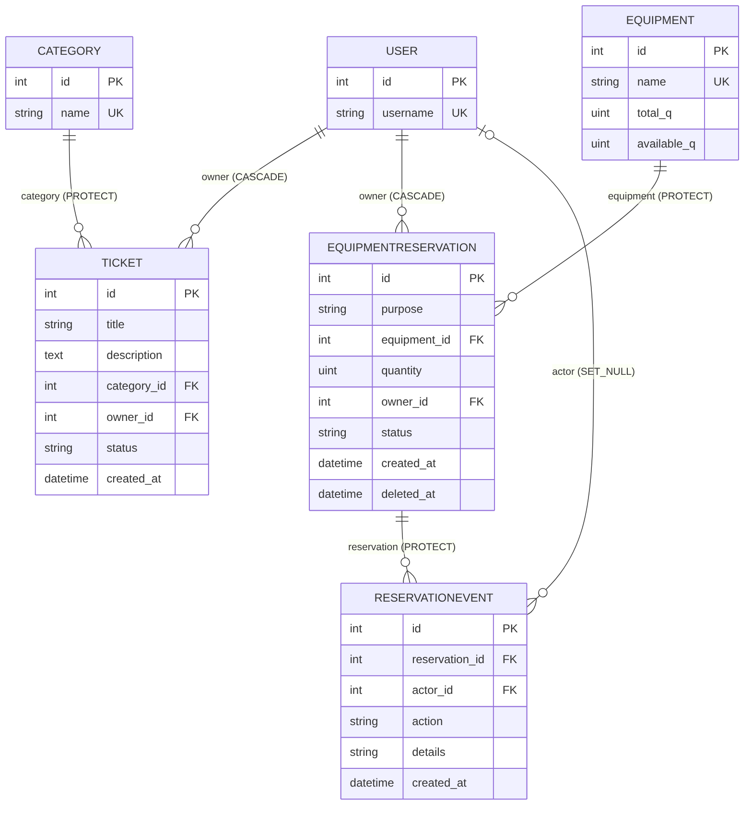
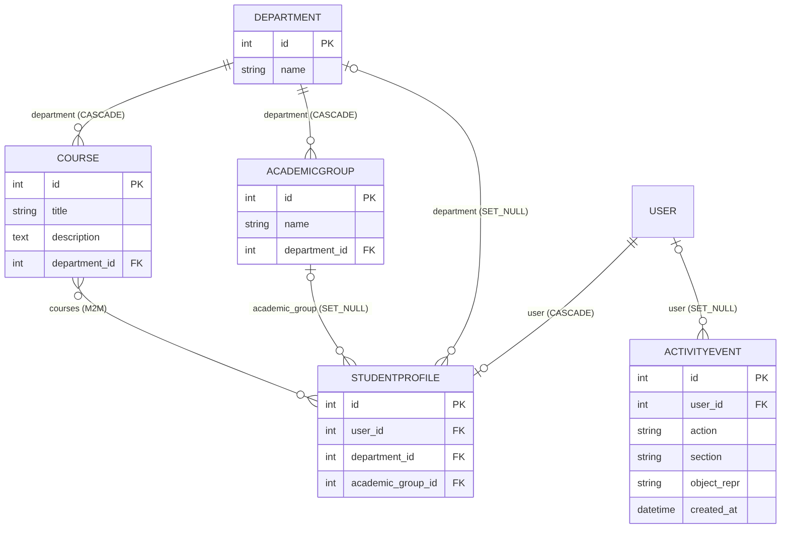

# База данных

Локально используется SQLite (`db.sqlite3`), в облаке — PostgreSQL. Схема создаётся
миграциями приложений (`python manage.py migrate`) и в обеих СУБД одинакова.

## Схема моделей: заявки и бронирование оборудования

*Рисунок 1 — связи сущностей (PK — первичный ключ, FK — внешний, UK — уникальное поле).*

## Модели и ключевые поля

### Category (`accounts_category`)
| Поле | Тип | Описание |
|------|-----|----------|
| `id` | PK | идентификатор |
| `name` | CharField(150), unique | название категории |

### Ticket (`accounts_ticket`) — заявка
| Поле | Тип | Описание |
|------|-----|----------|
| `id` | PK | |
| `title` | CharField(150) | название, не короче 5 символов (проверка сериализатора) |
| `description` | TextField, blank | описание |
| `category` | FK → Category, **PROTECT** | категорию с заявками удалить нельзя |
| `owner` | FK → User, CASCADE | владелец; назначается сервером |
| `status` | CharField(10) | `new` / `progress` / `done` |
| `created_at` | DateTime, auto | дата создания |

### Equipment (`accounts_equipment`) — оборудование
| Поле | Тип | Описание |
|------|-----|----------|
| `id` | PK | |
| `name` | CharField(150), unique | название |
| `total_q` | PositiveInteger | общее количество |
| `available_q` | PositiveInteger | доступный остаток; меняется только выдачей и возвратом |

### EquipmentReservation (`accounts_equipmentreservation`) — бронирование
| Поле | Тип | Описание |
|------|-----|----------|
| `id` | PK | |
| `purpose` | CharField(150) | назначение, не короче 5 символов |
| `equipment` | FK → Equipment, **PROTECT** | |
| `quantity` | PositiveInteger | количество, больше нуля |
| `owner` | FK → User, CASCADE | назначается сервером |
| `status` | CharField(10) | `created` / `issued` / `returned` |
| `created_at` | DateTime, auto | |
| `deleted_at` | DateTime, null | отметка «мягкого» удаления |

### ReservationEvent (`accounts_reservationevent`) — история
| Поле | Тип | Описание |
|------|-----|----------|
| `id` | PK | |
| `reservation` | FK → EquipmentReservation, **PROTECT** | |
| `actor` | FK → User, **SET_NULL**, null | инициатор; остаётся запись, если пользователь удалён |
| `action` | CharField(10) | `created`, `edited`, `issued`, `returned`, `deleted` |
| `details` | CharField(200) | пояснение |
| `created_at` | DateTime, auto | время события |

## Схема моделей: учебные данные и журнал активности

*Рисунок 2 — модели `Department`, `Course`, `AcademicGroup`, `StudentProfile` (приложение `accounts`) и `ActivityEvent` (приложение `dashboards`).*

| Модель | Назначение |
|--------|------------|
| `Department` | факультет |
| `Course` | курс, принадлежит факультету |
| `AcademicGroup` | учебная группа, принадлежит факультету |
| `StudentProfile` | профиль пользователя: факультет, группа, курсы (M2M) |
| `ActivityEvent` | журнал входов и изменений справочников; пишется сигналами |

## Поведение при удалении (`on_delete`)

| Связь | Правило | Смысл |
|-------|---------|-------|
| Ticket → Category, Reservation → Equipment, Event → Reservation | PROTECT | нельзя удалить объект, на который ссылаются |
| Ticket/Reservation → User (owner) | CASCADE | удаление пользователя удаляет его заявки и бронирования |
| Event → User (actor), ActivityEvent → User | SET_NULL | история сохраняется без привязки к пользователю |

## Целостность остатков

`available_q` изменяется только в `reservation_services.py` атомарным `UPDATE ... SET available_q = available_q ± quantity`
с условием в `WHERE` (`available_q >= quantity` при выдаче, `available_q <= total_q - quantity` при возврате).
Выдача и возврат выполняются в одной транзакции со сменой статуса и записью события; при сбое откатываются все изменения.

## Миграции

| Миграция | Что создаёт |
|----------|-------------|
| `accounts/0001` | `Department`, `Course`, `StudentProfile` |
| `accounts/0002`, `0003` | поле `Course.description`; `AcademicGroup` и `StudentProfile.academic_group` |
| `accounts/0004`–`0006` | `Category`, `Ticket`; затем поля `category`, `owner`, правка статуса и правил `on_delete` |
| `accounts/0007` | `Equipment`, `EquipmentReservation`, `ReservationEvent` |
| `dashboards/0001` | `ActivityEvent` |

Просмотр состояния: `python manage.py showmigrations`. Проверка, что модели и миграции согласованы:
`python manage.py makemigrations --check --dry-run`.

## SQLite и PostgreSQL — разные базы

Локальный `db.sqlite3` и облачная PostgreSQL никак не связаны. Данные, созданные локально, в облаке не появятся, и наоборот.
Перенос выполняется только вручную — см. [backup-restore.md](backup-restore.md).
