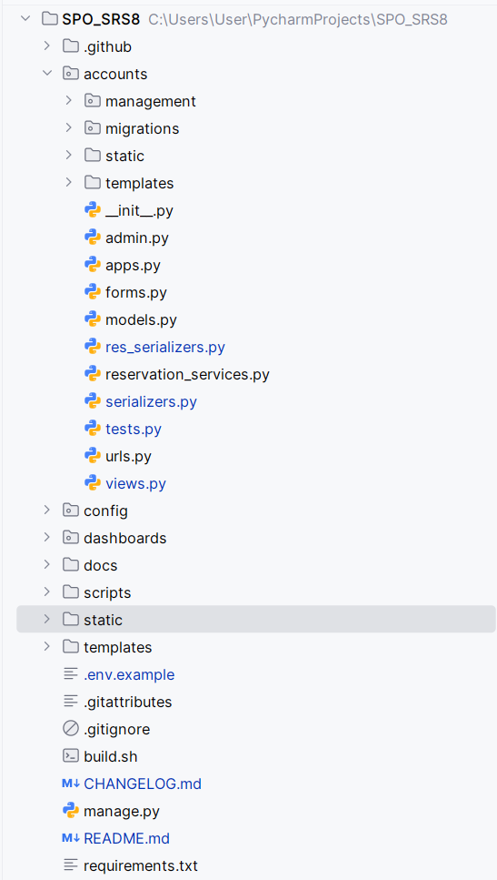

# Структура проекта

## Каталоги

| Путь | Назначение |
|------|------------|
| config/ | настройки (переменные окружения), маршруты, WSGI, storage.py для статики |
| accounts/ | модели, API, страницы заявок и бронирований, автотесты, команды |
| dashboards/ | дашборды и журнал ActivityEvent |
| templates/, static/ | шаблоны и файлы оформления |
| staticfiles/ | создается командой collectstatic, в Git не хранится |
| scripts/ | check_docs.py, verify_clean_start.sh, smoke_api.py, backup_restore.py, release_notes.py, ci_local.py, make_env.py |
| docs/ | документация; api-reference.md и openapi.json создаются автоматически |

## Файлы настроек

| Файл | Назначение | Есть ли секреты |
|------|------------|-----------------|
| config/settings.py | настройки, чтение переменных окружения | нет |
| .env.example | образец переменных | нет |
| .env | локальные значения | да, в Git не попадает |
| requirements.txt | зависимости | нет |
| build.sh | установка зависимостей и collectstatic на Render | нет |
| .gitignore | исключает .env, db.sqlite3, staticfiles/, backups/ | нет |
| .gitattributes | правила переводов строк | нет |
| .github/workflows/ci.yml | автопроверки | нет, только тестовые значения |
